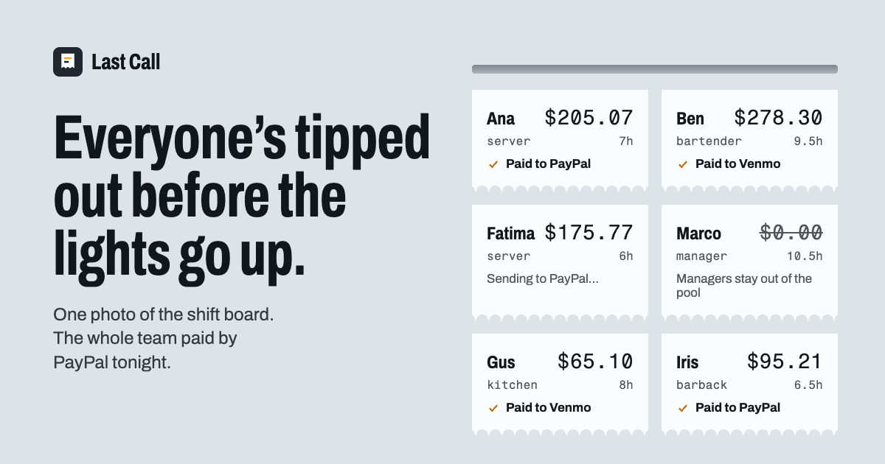
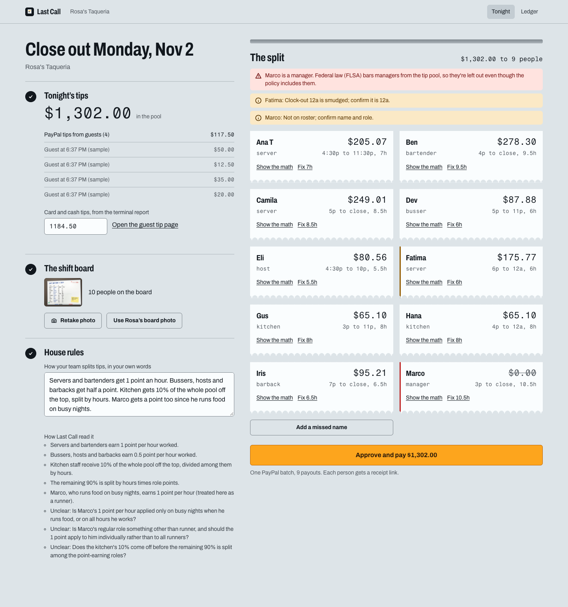
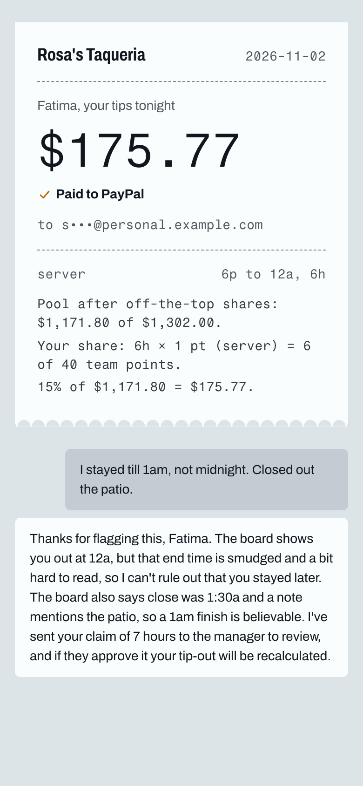
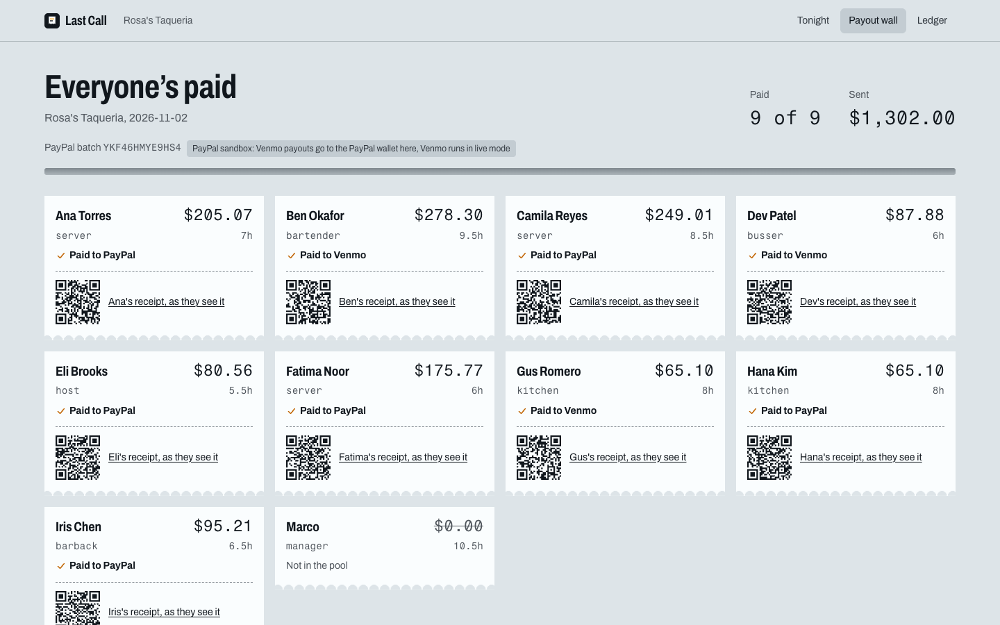

<p align="center"></p>

# Last Call

**Close out the night's tip pool from one photo of the shift board. Everyone is paid by PayPal before they leave, with a receipt that shows the math.**

**[Try the live demo →](https://lastcall.vercel.app)** No sign-up. You get your own copy of a sample taqueria, and real PayPal sandbox money moves.

Built for the [PayPal AI Hackathon 2026](https://paypalaihackathon.devpost.com).

---

## The problem

It's 1:30am. The last table is gone. In most independent restaurants, the manager now splits the night's tips by hand: who worked how long, who gets a full share, who gets half, how much goes to the kitchen. Then they hand out cash, or send nine separate Venmos.

- **The math is error-prone,** and nobody can check it.
- **The law has traps.** Under the US Fair Labor Standards Act (29 U.S.C. §203(m)(2)(B)), managers and supervisors can't keep any part of the tip pool. Owners still get this wrong.
- **Cash is slow and risky**, and many workers now never carry it.

Tools like Kickfin, TipHaus and 7shifts solve this only if you run a supported POS. Most small places don't.

**Last Call needs no POS. It needs a photo and a sentence.**

## How it works

| | |
|---|---|
| **1. Tips come in through PayPal.** Guests tip from a QR code (PayPal Checkout). The manager adds card and cash tips from the terminal report. | **2. Snap the shift board.** Whiteboard, printout or sign-in sheet. Claude reads names, roles and in/out times, fixes spellings against the staff list, and flags only what a manager must double-check. |
| **3. House rules in plain English, once.** *"Bussers get half a point. Kitchen gets 10% off the top."* Claude turns that into structured rules and reads them back, including anything it found unclear. | **4. The math runs in code, never in the model.** Integer cents and largest-remainder rounding, so the shares always add up to the cent. Managers are kept out of the pool automatically, and the screen says why. |
| **5. Approve and pay.** One PayPal **Payouts** batch pays the whole team to PayPal or Venmo. | **6. Everyone gets a receipt.** A link with their share worked out line by line, and a way to say *"I stayed till close."* Claude checks the claim against the board photo, the manager approves, and a **top-up payout** goes out. |

<table>
<tr>
<td width="62%"></td>
<td width="38%"></td>
</tr>
<tr>
<td><sub>The close-out. Claude read the board photo. Marco is a manager, so he's out of the pool, and Fatima's smudged out-time is flagged.</sub></td>
<td><sub>Fatima's receipt. She says she stayed till 1am; Claude checks the board and sends it to the manager.</sub></td>
</tr>
</table>


<sub>The payout wall. Each ticket flips to paid as PayPal's payout webhooks arrive. Every QR code opens that person's receipt on a phone.</sub>

## How PayPal is used

| PayPal API | What it does in Last Call |
|---|---|
| **Payouts v1** create batch | Pays the whole team in one call: PayPal email or Venmo phone. `sender_batch_id` is the night's id, so a retry or double tap can never pay twice. |
| **Payouts v1** get batch | Polls item status as a fallback to webhooks. |
| **Webhooks** `PAYMENT.PAYOUTS-ITEM.*` + verify-webhook-signature | Live status on the payout wall. Every event is verified with PayPal and deduplicated by event id. |
| **Payouts v1** single-item batch | Top-ups after an approved correction (`sender_batch_id` = the dispute id). |
| **Orders v2** create + capture, **JS SDK** buttons | Guest tips go straight into tonight's pool, deduplicated by order id. |
| **OAuth 2.0** client credentials | Server-to-server auth. Keys never reach the browser. |

PayPal's Agent Toolkit doesn't cover Payouts, so Last Call calls the REST API directly.

> **Sandbox note:** PayPal's sandbox rejects `recipient_wallet: VENMO`, so in the demo, Venmo workers are paid to their PayPal wallet and the screen says so. Against the live API the same code sends Venmo.

## How AI is used (and where it isn't)

Claude Sonnet 5.5, via the Anthropic SDK with **structured outputs**, does three jobs. Each one turns messy human input into checked data:

1. **Reading the shift board** (vision). Rows, roles, times, a confidence score per row, and a note only where the manager should look.
2. **Reading the house rules.** Points per role, off-the-top pools, exclusions, a plain-English read-back, and the questions it couldn't answer.
3. **Checking a worker's dispute** against the board photo and the original read, then writing a fair reply.

**It never touches money.** Every amount comes from a tested TypeScript function ([`convex/lib/split.ts`](convex/lib/split.ts)), and the server recomputes everything at approval. The legal check (no managers in the pool) is code too, so the model can't talk its way around it.

## Built to handle real money

- **Idempotent payouts:** the batch id comes from the night, the top-up id from the dispute.
- **Webhooks** are signature-verified with PayPal and deduplicated; polling backs them up.
- **Every outbound call** has a timeout, with retries plus backoff and jitter on 429/5xx only.
- **AI spend caps:** per restaurant and per day.
- **Server-side checks:** amounts, hours, image type and size, text length.
- **A human approves** before any money moves.

## Stack

- **React + TypeScript** (Vite), hosted on Vercel
- **[Convex](https://convex.dev)**: database, server functions, file storage, scheduler, and the PayPal webhook endpoint. Live queries make the payout wall update without polling from the browser.
- **Claude Sonnet 5.5** (Anthropic SDK, structured outputs)
- **PayPal REST API** (sandbox)
- **AG Grid** for the ledger of every night and every share

## Run it yourself

```bash
npm install
npx convex dev        # creates a Convex dev deployment, writes .env.local
npm run dev
```

Set these on the Convex deployment (`npx convex env set NAME value`):

| Variable | Purpose |
|---|---|
| `PAYPAL_CLIENT_ID`, `PAYPAL_SECRET` | PayPal sandbox app. Without them, payouts are simulated and labelled on screen. |
| `PAYPAL_WEBHOOK_ID` | Sandbox webhook for `PAYMENT.PAYOUTS-ITEM.*`, pointed at `https://<deployment>.convex.site/paypal/webhook` |
| `ANTHROPIC_API_KEY` | Claude. Without it, the demo uses a canned read of the sample board. |
| `APP_URL` | Public URL, used in receipt links |
| `DEMO_RECEIVERS` | Optional JSON list that maps the demo staff to your sandbox accounts |

Tests for the split engine: `npx vitest run`

## License

[MIT](LICENSE)
